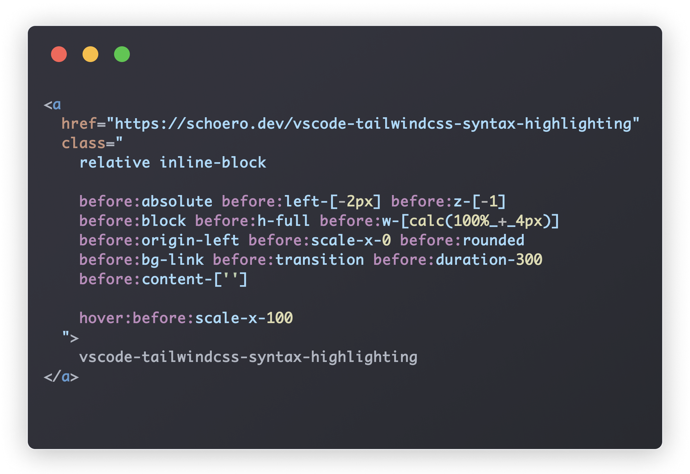

<div align="center">
  <picture>
    <source srcset="./assets/logo.svg">
    
  </picture>
</div>

<h1 align="center">Syntax Highlighting for Tailwind CSS</h1>

<br/>
<br/>

<div align="center">

  [](https://github.com/schoero/vscode-tailwindcss-syntax-highlighting/blob/main/LICENSE)
  [](https://github.com/schoero/vscode-tailwindcss-syntax-highlighting/issues)
  [](https://github.com/schoero/vscode-tailwindcss-syntax-highlighting/stargazers)
  [](https://github.com/schoero/vscode-tailwindcss-syntax-highlighting/actions?query=workflow%3ACI)

</div>

<br/>
<br/>

<div align="center">
  VSCode extension that adds syntax highlighting for tailwindcss classes in HTML, JSX, TSX, Svelte, Vue and CSS files.
</div>

<br/>
<br/>

<div align="center">
  
</div>

<br/>
<br/>

<div align="center">
  <a href="https://github.com/sponsors/schoero">
    <picture>
      <source srcset="./assets/sponsor-dark.svg">
      
    </picture>
  </a>
</div>

<div align="center">
  This project is financed by the community.  
  If you or your company benefit from this project, please consider becoming a sponsor or making a one-time donation.  
  Your contribution will help me to maintain and develop the project.
</div>

<br/>
<br/>

### Classes in function calls, variables and tagged templates

Besides `class` and `className` attributes, the extension also highlights classes in

- calls of utilities like `cn()`, `clsx()`, `cx()`, `cc()`, `twMerge()`, `twJoin()`, `ctl()`, `objstr()`, `cnb()`, `dcnb()`, `clb()`, `cva()` and `tv()`
- variables named `className`, `classNames`, `classes`, `style` or `styles`
- `twc` and `twx` tagged templates of [twc](https://github.com/gregberge/twc)
- expressions in `class` and `className` attributes, like `className={isActive ? "font-bold" : "font-normal"}`
- `class:` directives in Svelte, like `class:font-bold={isActive}`
- bound classes in Vue, like `:class="{ 'font-bold': isActive }"`
- inline `<script>` tags in HTML
- `@apply` rules in CSS, SCSS, Less and PostCSS files, and in `<style>` tags of HTML, Svelte and Vue files

Only strings that end up as classes are highlighted. Strings in comparisons, in the condition of a ternary, on the left side of `&&` and `||`, in object values of `cn()` and similar calls, or in nested function calls are ignored.

```tsx
cn(
  variant === "primary" && "bg-blue-500", // "primary" is ignored, "bg-blue-500" is highlighted
  { "font-bold": isActive }               // "font-bold" is highlighted
);
```

The strings are found with the same matchers as in [eslint-plugin-better-tailwindcss](https://github.com/schoero/eslint-plugin-better-tailwindcss).

In HTML, attribute values are plain strings, so attribute selectors only apply to them when they have no `match`, like the default `class` selector.

#### Configuration

| Setting | Description |
| --- | --- |
| `tailwindcssSyntaxHighlighting.enabled` | Turns the highlighting on or off. |
| `tailwindcssSyntaxHighlighting.selectors` | Selectors that decide which strings are highlighted, in the same format as the [`selectors` option](https://github.com/schoero/eslint-plugin-better-tailwindcss/blob/main/docs/settings/settings.md#selectors) of the ESLint plugin. |

Like in the ESLint plugin, `tailwindcssSyntaxHighlighting.selectors` replaces the default selectors. Its default value is the full list of default selectors, which VS Code shows when you edit the setting in `settings.json`. Remove the entries you don't need and add your own.

For example, to only highlight `cn()` calls and a custom `myUtility()` function:

```jsonc
{
  "tailwindcssSyntaxHighlighting.selectors": [
    {
      "kind": "callee",
      "name": "^cn$",
      "match": [{ "type": "strings" }, { "type": "objectKeys" }]
    },
    {
      "kind": "callee",
      "name": "^myUtility$",
      "match": [{ "type": "strings" }]
    }
  ]
}
```

<br/>
<br/>

### Customization

The colors can be customized in the user settings of vscode with `workbench.colorCustomizations`. To open the user settings you can open the command palette with
<kbd>F1</kbd> and search for `Preferences: Open User Settings (JSON)`.

```jsonc
{
  "workbench.colorCustomizations": {
    // tailwind classes
    // hover:text-black-500
    //       ^^^^^^^^^^^
    "tailwindcss.class": "#AFD9F8",
    // tailwind variants
    // hover:text-black-500/10
    // ^^^^^^
    "tailwindcss.variant": "#B583D3",
    // the property name of an arbitrary property
    // hover:[top:_10px]
    //        ^^^
    "tailwindcss.propertyName": "#CA7979",
    // the value of an arbitrary property
    // [top:_10px] bg-[#fff]
    //                 ^^^^
    "tailwindcss.propertyValue": "#BABABA",
    // numbers
    // text-red-500 [top:_10px]
    //          ^^^       ^^
    "tailwindcss.number": "#DDDBB4",
    // units
    // [top:_10px]
    //         ^^
    "tailwindcss.unit": "#DDDBB4",
    // square brackets
    // w-[calc(100%_+_4px)]
    //   ^                ^
    "tailwindcss.bracket": "#AFD9F8",
    // css functions in arbitrary values
    // w-[calc(100%_+_4px)]
    //    ^^^^
    "tailwindcss.function": "#DDDBB4",
    // round brackets
    // w-[calc(100%_+_4px)] bg-(--brand)
    //        ^          ^     ^       ^
    "tailwindcss.parenthesis": "#AFD9F8",
    // operators and negative prefixes
    // w-[calc(100%_+_4px)] text-red-500/10 -mt-2
    //              ^                   ^   ^
    "tailwindcss.operator": "#BABABA",
    // the important modifier
    // !text-red-500 text-red-500!
    // ^                         ^
    "tailwindcss.important": "#BABABA",
    // css selectors in arbitrary variants
    // [&>div]:p-4
    //  ^^^^^
    "tailwindcss.selector": "#DDDBB4",
    // the tailwindcss whitespace substitute
    // [top:_10px]
    //      ^
    "tailwindcss.whitespace": "#CA797966",
    // quoted strings
    // before:content-['content']
    //                 ^^^^^^^^^
    "tailwindcss.string": "#A6C088",
    // css variables
    // [top:_var(--my-var)]
    //           ^^^^^^^^
    "tailwindcss.cssVariable": "#CA7979",
    // css currentColor
    // [background-color:_currentColor]
    //                    ^^^^^^^^^^^^
    "tailwindcss.currentColor": "#80C4B2",
    // commas and the colon of arbitrary properties
    // [top:_10px] [margin:1px,2px]
    //     ^              ^   ^
    "tailwindcss.punctuation": "#BABABA"
  }
}
```

<br/>
<br/>

### Want to further improve the readability of your tailwindcss classes?

Check out [eslint-plugin-readable-tailwind](https://github.com/schoero/eslint-plugin-readable-tailwind) to automatically break up long tailwind class strings into multiple lines based on a specified print width or class count.
